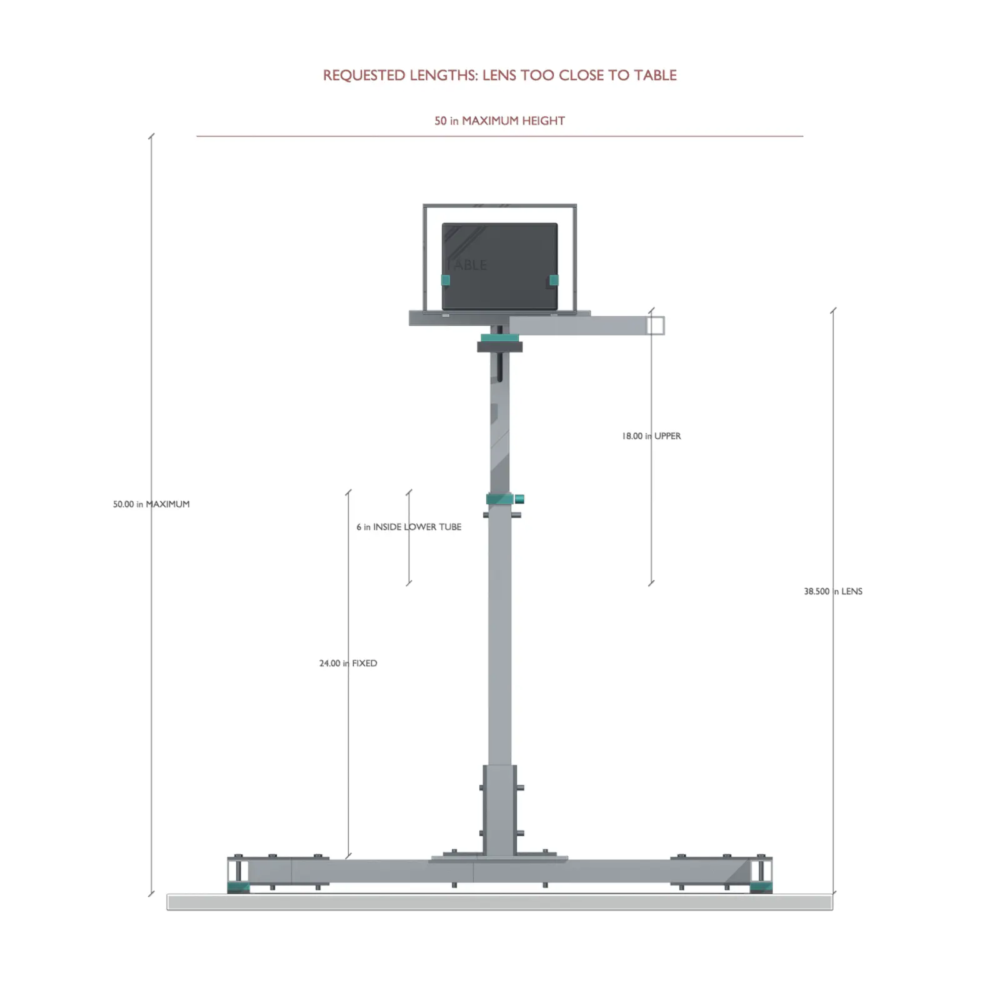
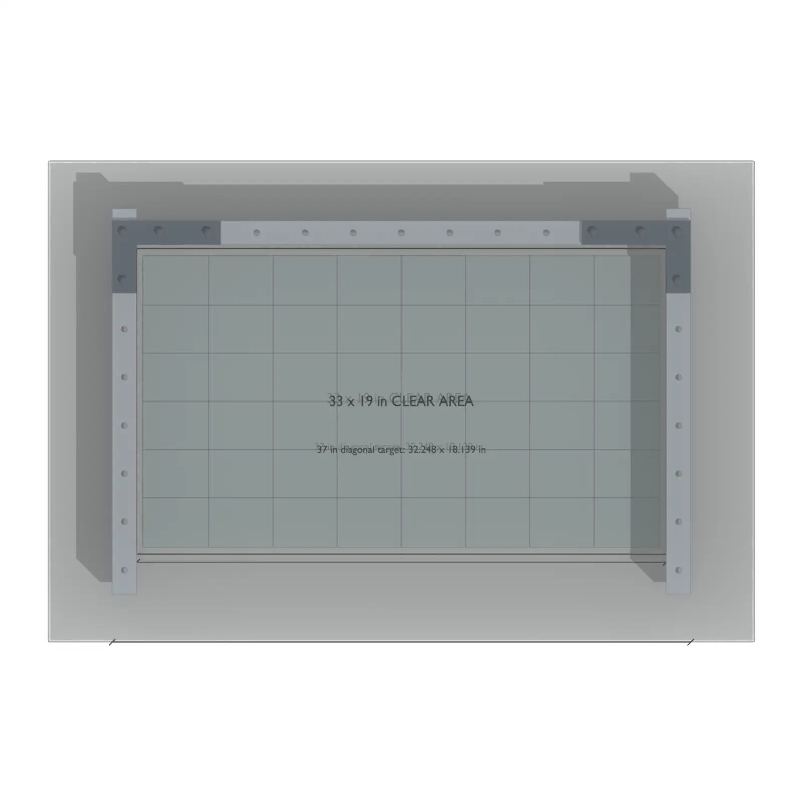
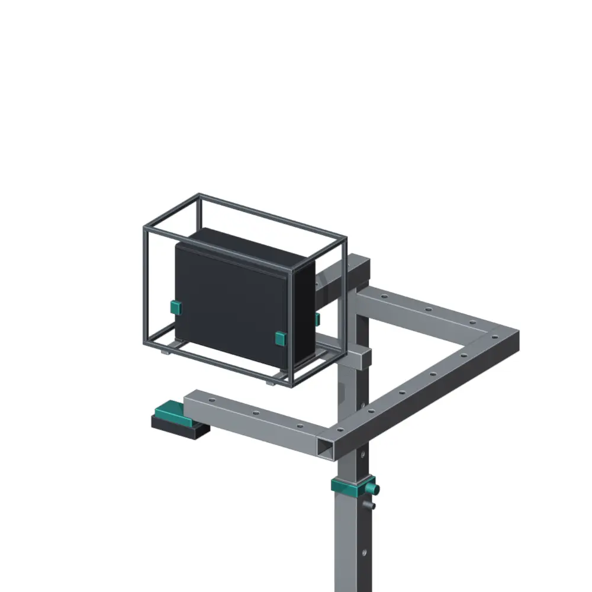
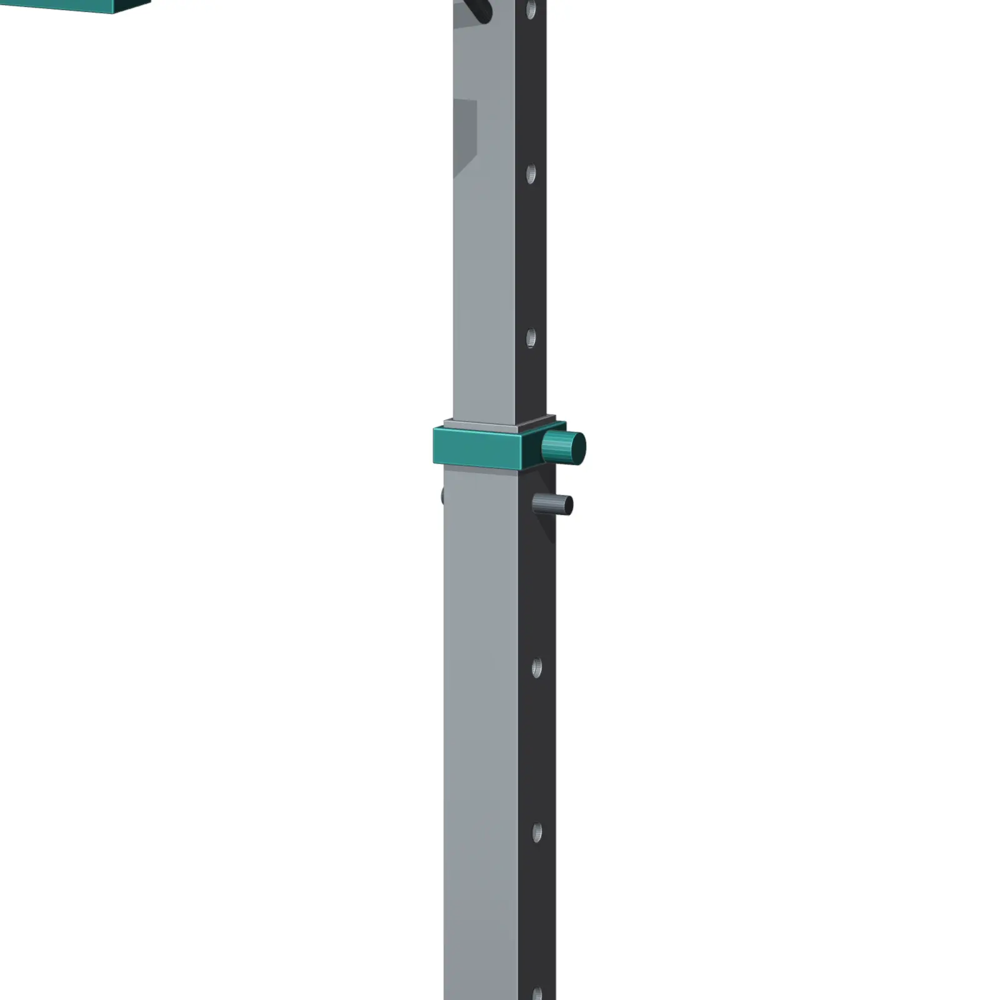

# Enclosure and mounting concept

The current mechanical model explores an overhead structure that positions the
camera and projection equipment above a tabletop work area. The editable model
is stored at `hardware/models/skeye_compact.blend`.

<figure class="skeye-feature-image">
  
  <figcaption>Front view of the current assembled concept</figcaption>
</figure>

## Component views

  <figure>
    
    <figcaption>Base</figcaption>
  </figure>
  <figure>
    
    <figcaption>Equipment head</figcaption>
  </figure>
  <figure>
    
    <figcaption>Tube joint</figcaption>
  </figure>

## Design file

[Open the model directory on GitHub](https://github.com/aswenson1/SkEye/tree/main/hardware/models)
to download the Blender source and original renders.

## Scope

These images are concept renders, not manufacturing drawings. Dimensions,
tolerances, and material specifications are not documented here.

