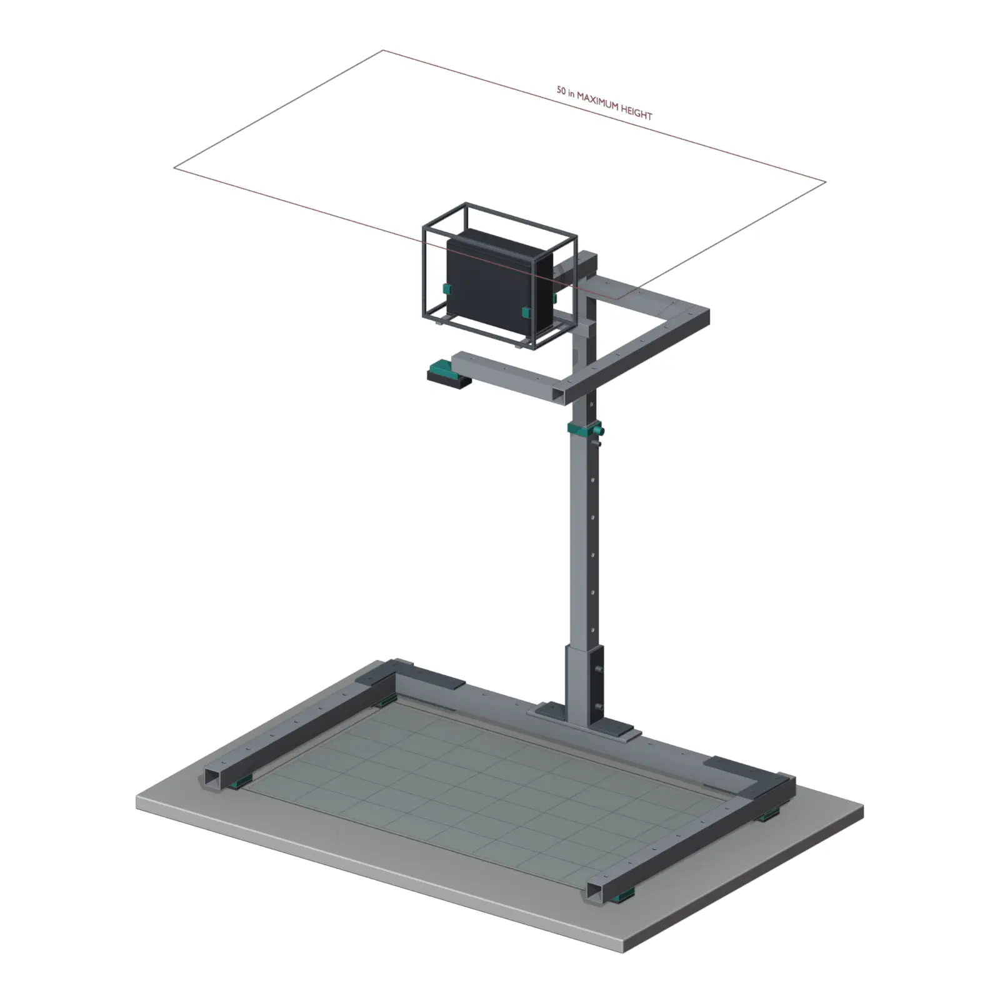

SKEYE / DOCUMENTATION

# SkEye

SkEye is a tabletop mapping system. It tracks physical objects and displays
information around them.

[System](system/overview.md){ .md-button .md-button--primary }
[Hardware](hardware/index.md){ .md-button }

<figure class="skeye-hero__media">
  
  <figcaption>Current mechanical concept render</figcaption>
</figure>

## System

### Camera

Captures markers and objects on the table.

### Host

Converts detections into positions and application state.

### Output

Displays information in the physical workspace.

## Repository

The repository contains the mechanical model and a preliminary Raspberry Pi Pico
controller PCB. The `software/` directory is currently empty.

Controller status: ERC, DRC, and hardware testing have not been completed.

[Source](https://github.com/aswenson1/SkEye){ .md-button }
[Pitch](https://youtu.be/Z7oEOcuJgw8){ .md-button }

