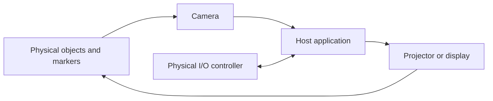

# System overview

SkEye is intended to connect a physical tabletop scene with a programmable
digital layer. The system observes the surface, interprets tracked objects, and
returns contextual information through a projector or display.

## Responsibilities

| Subsystem | Responsibility | Repository area |
| --- | --- | --- |
| Mechanical structure | Holds and aligns sensing/display equipment above the work surface | `hardware/models/` |
| Camera | Captures the tabletop scene for marker and object tracking | Integration pending |
| Host application | Converts observations into tracked state and rendered information | `software/` |
| Display path | Projects or displays information around physical objects | Integration pending |
| Controller | Supplies buttons, status LEDs, and a 3.3 V UART development connection | `hardware/SkEye_Controller/` |

## Design boundaries

- Camera and projector connections terminate at the host computer; they do not
  pass through the controller PCB.
- The current controller is based on a socketed Raspberry Pi Pico or Pico H.
- The repository does not yet contain a committed host application or controller
  firmware, so software interfaces remain to be defined.

## Maintenance

This page describes the intended architecture. Update it when implementation
decisions are committed to the repository.

